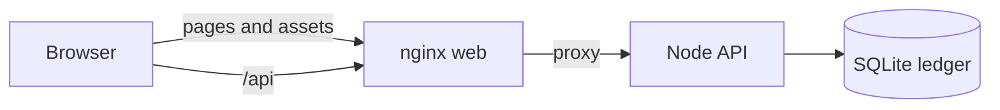

# Assetflow

[](https://github.com/seajin0205-gif/Assetflow/actions/workflows/ci.yml)


Assetflow is a portfolio-intelligence workspace with a trading ticket. The dashboard summarizes risk, holdings, and market context. The trade ticket submits orders to an API that keeps cash, reservations, and idempotency keys in one SQLite transaction.

## Overview

The browser loads a React single-page application. In production, nginx serves that application and proxies `/api` to a Node.js process. The API validates each order, locks the account row with a SQLite write transaction and an optimistic version check, and returns either the order or an [RFC 7807](https://datatracker.ietf.org/doc/html/rfc7807) problem document.

The ledger is a SQLite file (`ORDER_DB_PATH`). Idempotency and balance updates are stored in that database. The process does not depend on PostgreSQL or Redis; adding either service without a caller would not change the safety guarantees.



## Tech stack

| Layer    | Choice                                             |
| -------- | -------------------------------------------------- |
| UI       | React 18, React Router 6, Tailwind CSS 3, Recharts |
| Build    | Vite 8, TypeScript 5.9                             |
| API      | Express 5, Zod                                     |
| Ledger   | Node.js 22 `node:sqlite`                           |
| Tests    | Vitest, Testing Library, Playwright                |
| Delivery | Docker Compose, GitHub Actions                     |

## Key features

- **Live quote stream.** A simulated socket ticks NVIDIA, Apple, Tesla, and Microsoft once a second. Rising prints flash green and falling prints flash red, the chart tip follows the last trade, and the header shows `WS Connected` with a moving latency reading. The trade ticket also subscribes to a simulated book feed that replaces the five ask levels and five bid levels around the selected mid price.
- **Concurrency safety.** Order placement and cancellation run inside `BEGIN IMMEDIATE`. The account update matches the version read at the start of the transaction, so a stale write rolls back. Cash, reserved buying power, and reserved shares commit together. A repeated `Idempotency-Key` returns the original response and does not fill twice.
- **Localized trade copy.** The portfolio dashboard is English. The trade ticket, including validation and insufficient-funds feedback, is Korean.
- **Bounded trading traffic.** `/api/orders` accepts 10 requests per second for each `X-User-Id`, or for the client IP when that header is absent.

## Local quick start

### Prerequisites

- Node.js 22
- pnpm 10.14
- Google Chrome, only if you run the Playwright journey
- Docker Engine with Compose, only if you run the container stack

### Environment

Copy nothing to start. The development server keeps the ledger in memory. Set `ORDER_DB_PATH` when you want the file to survive a restart. `PORT` defaults to `3000` for the production server and the Vite dev server uses `8080`. `HOST` defaults to `0.0.0.0` in the production process.

### Application commands

```bash
pnpm install
pnpm dev
```

Open [http://127.0.0.1:8080](http://127.0.0.1:8080). The trade ticket is [http://127.0.0.1:8080/trade](http://127.0.0.1:8080/trade).

```bash
pnpm lint
pnpm typecheck
pnpm test
pnpm test:coverage
pnpm test:e2e
pnpm build
pnpm start
```

### Docker

From the repository root:

```bash
docker compose up --build
```

The web container listens on [http://127.0.0.1:8080](http://127.0.0.1:8080). nginx serves the built client and forwards `/api` to the API container. The API writes `orders.sqlite` to the `order-data` volume and drops to the `node` user before it serves traffic. Stop the Vite dev server first if it already owns port 8080, or set `WEB_PORT` to publish the site on another port.

```bash
docker compose down
```

## API

Responses that fail use `Content-Type: application/problem+json` and the fields `type`, `title`, `status`, `detail`, and `instance`.

| Method   | Path              | Purpose                                          |
| -------- | ----------------- | ------------------------------------------------ |
| `GET`    | `/api/ping`       | Liveness payload                                 |
| `GET`    | `/api/demo`       | Sample JSON payload                              |
| `POST`   | `/api/orders`     | Place a market or limit order                    |
| `GET`    | `/api/orders/:id` | Read one order for the calling account           |
| `DELETE` | `/api/orders/:id` | Cancel an open order and release its reservation |

`POST` and `DELETE` require:

- `X-User-Id`: 1–64 letters, numbers, underscores, or hyphens. The seeded account is `demo`.
- `Idempotency-Key`: 8–200 characters from `A-Z`, `a-z`, `0-9`, and `. _ : -`.

Place-order body:

```json
{
  "symbol": "NVDA",
  "side": "buy",
  "type": "limit",
  "quantity": 4,
  "limitPrice": 890
}
```

`symbol` is one of `NVDA`, `AAPL`, `TSLA`, and `MSFT`. `quantity` is a positive integer. `limitPrice` is required when `type` is `limit` and omitted when `type` is `market`. A successful create returns `201` and the order. The same key and body return that order again with `Idempotent-Replayed: true`. The same key with a different body returns `409`.

Market orders fill at the server quote. Limit orders stay `open` and reserve cash for a buy or shares for a sell. Cancelling an open order releases that reservation. Cancelling a filled order returns `409`.

## Tests and coverage

`pnpm test` runs the Vitest suites:

- `server/orders/order-placement.spec.ts` checks validation, buying power, share availability, idempotent replay, key mismatch, unknown accounts, and malformed JSON.
- `server/orders/orders.spec.ts` checks the HTTP workflow, cancellation, concurrent buys, and the rate limit.
- `client/hooks/use-order-book.spec.tsx` checks the book ladder, tick updates, and unsubscribe.
- `client/lib/utils.spec.ts` checks the class-name helper.

`pnpm test:coverage` prints a text report and writes `coverage/lcov.info`. Coverage is collected from `server`, `client/hooks`, and `shared`, excluding the spec files. `pnpm test:e2e` opens the trade ticket in Chrome, fills price and quantity, and asserts both the acceptance toast and the insufficient-funds message against a mocked `/api/orders` response.

GitHub Actions runs lint, typecheck, unit tests, and the production build on every pull request and every push to `main`.

## Project layout

```text
client/     React application, including the trade ticket and order book hook
server/     Express API, order ledger, and production process entry
shared/     Types used by the client and the server
e2e/        Playwright journey
docker/     nginx site config
```
